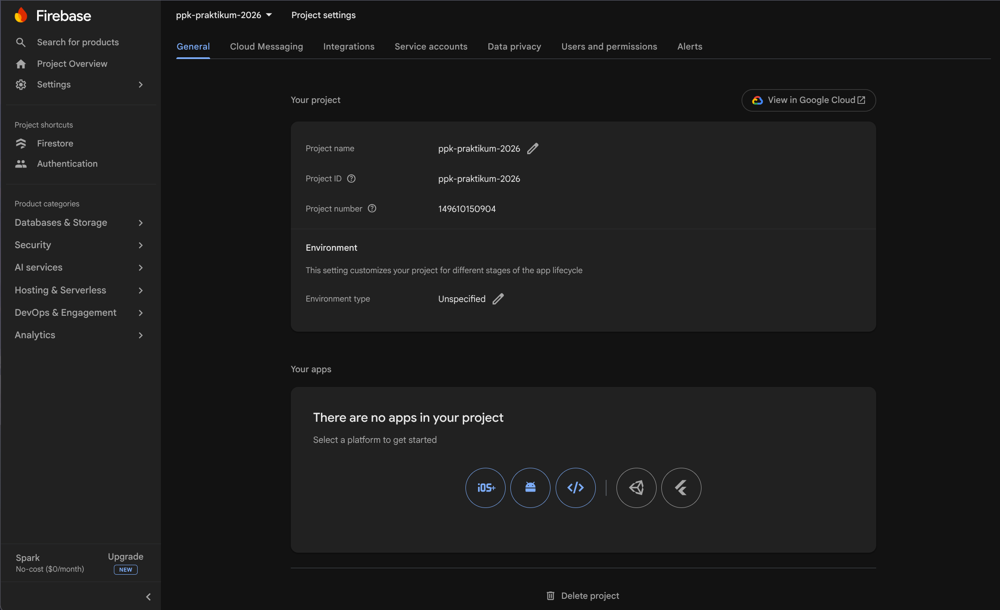
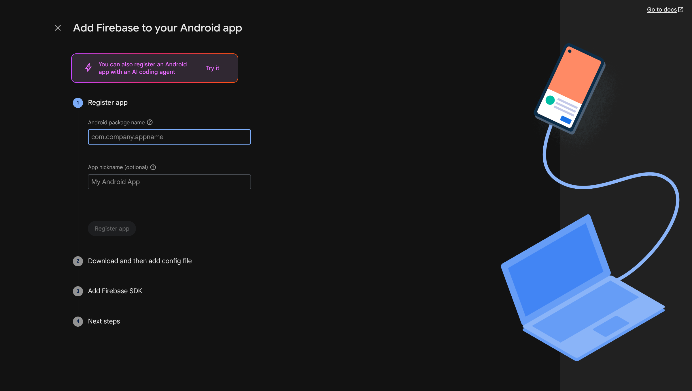
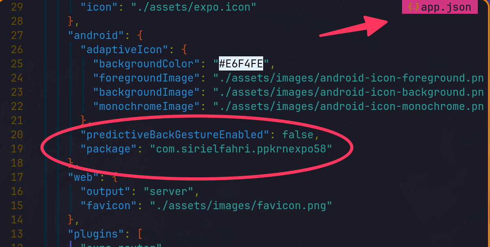
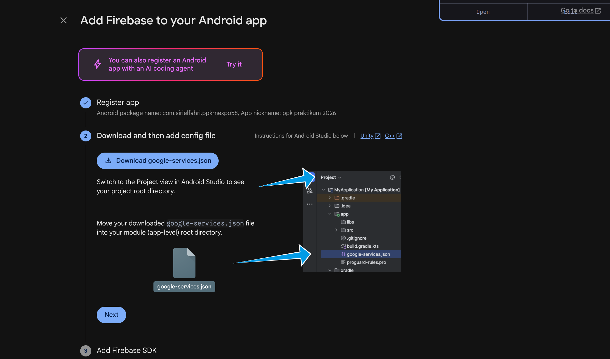
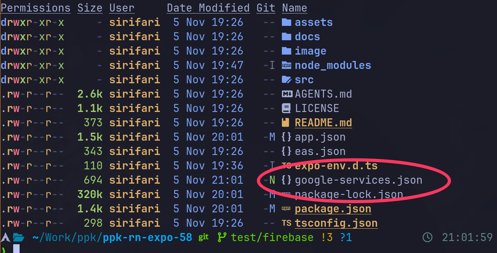
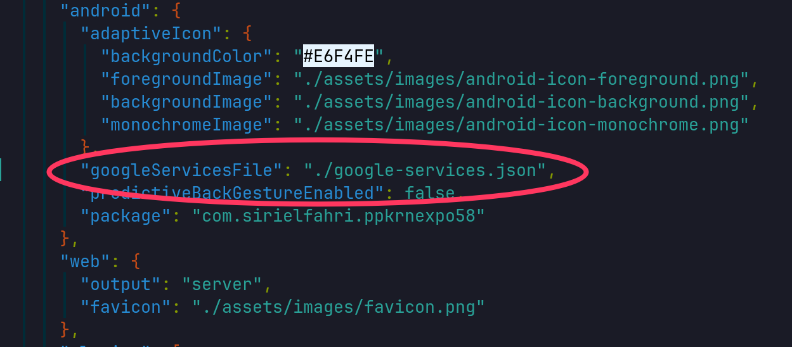

# Hubungkan Firebase ke React Native

Panduan ini mendaftarkan aplikasi Android React Native/Expo ke Firebase dan memasang file konfigurasi project. Tujuannya agar native Firebase SDK pada aplikasi mengarah ke project Firebase yang benar.

Contoh dan screenshot di bawah menggunakan aplikasi Android.

1. Dari **Project settings**, pilih untuk menambahkan aplikasi Android.
   
   > **Gambar:** Bagian aplikasi pada Project settings. Pilih ikon Android untuk mendaftarkan aplikasi Android.
2. Masukkan Android package name. Untuk project Expo pada screenshot, nilainya diambil dari `android.package` di `app.json`.
   
   
   > **Gambar:** Contoh nilai `android.package` yang perlu disalin ke Firebase Console saat registrasi. Jikalau belum ada, bisa hardcoded tulis aja dengan format **com.{bebas}.{bebas}**
3. Daftarkan aplikasi, unduh `google-services.json`, lalu letakkan file di root project.
   
   
4. Tambahkan konfigurasi (hardcoded tulis) `googleServicesFile` di bagian `android` pada `app.json`, kemudian lanjutkan langkah berikutnya di Firebase Console.
   

---

[Kembali: Setup Authentication](Setup%20Authentication.md)

[Awal: Beranda Firebase](Firebase%20Console.md)

[Lanjut: Testing Login dan Logout](Testing%20Login%20dan%20Logout%20React%20Native.md)
