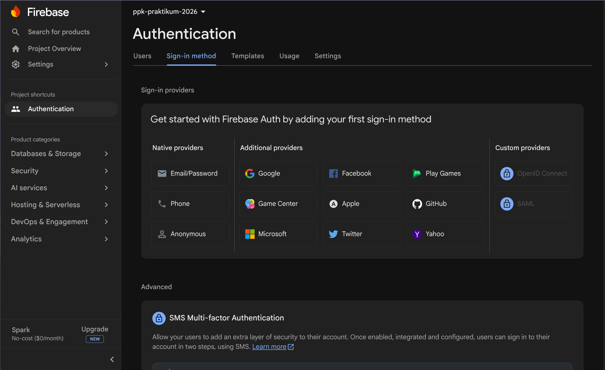
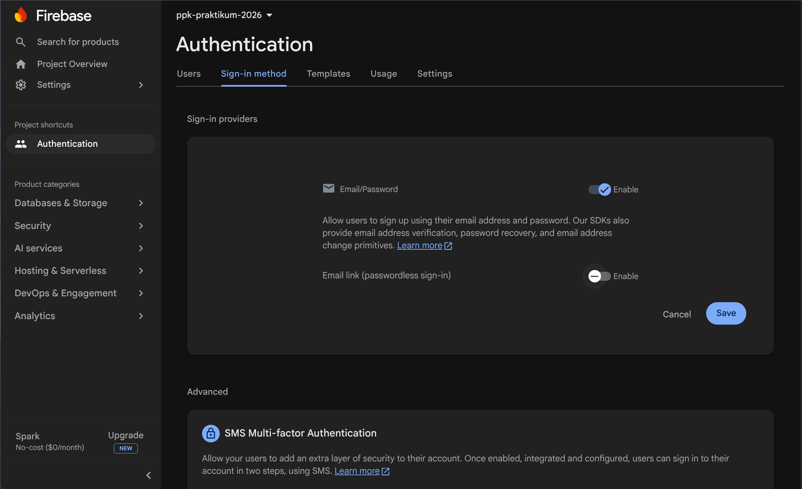
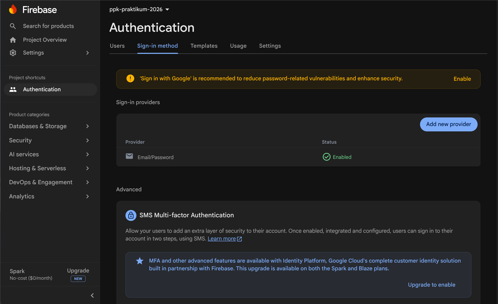
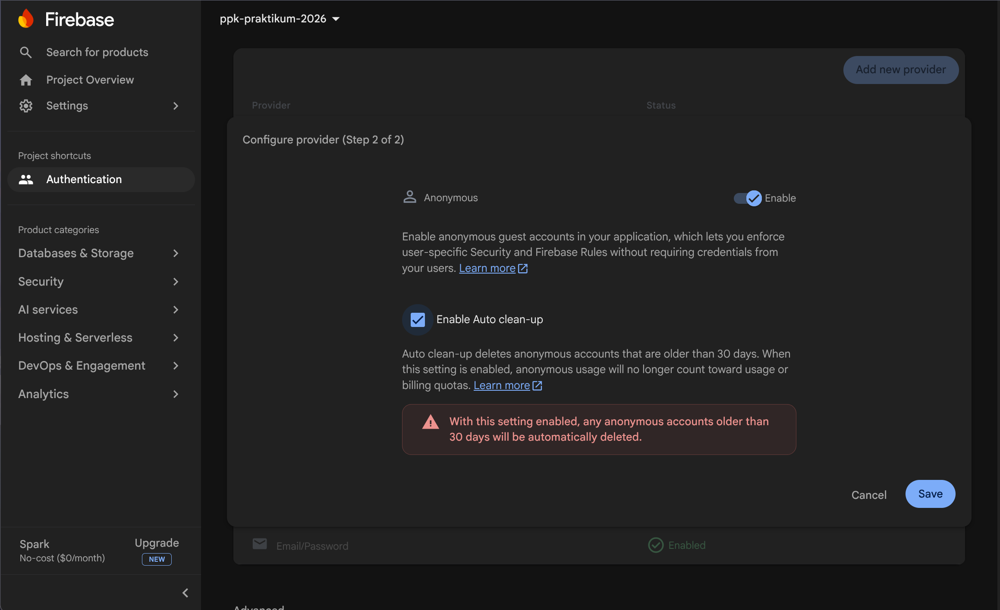
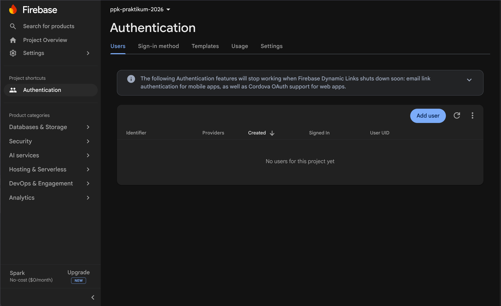
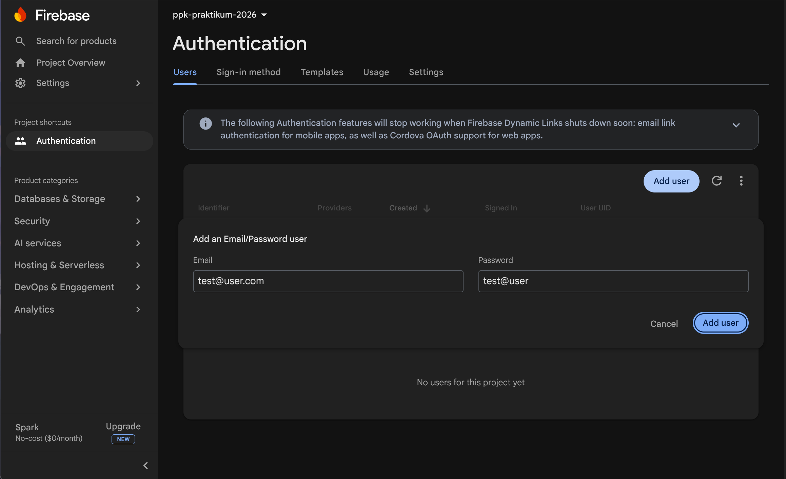
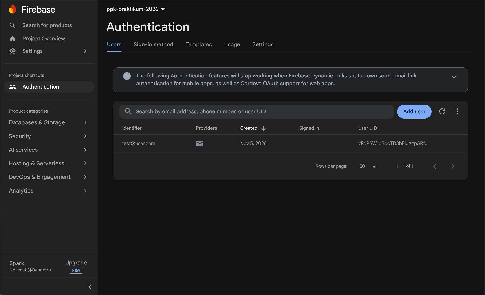

# Setup Authentication

Panduan ini mengaktifkan Firebase Authentication dengan provider Email/Password dan membuat akun uji. Hasilnya adalah kredensial yang bisa dipakai untuk memverifikasi login dari aplikasi React Native.

1. Buka **Authentication** dari menu project.
   
   > **Gambar:** Halaman Authentication dengan daftar metode sign-in yang tersedia.
2. Pilih metode **Email/Password**, aktifkan, lalu simpan.
   
   > **Gambar:** Pilih provider **Email/Password** untuk mengizinkan pengguna masuk memakai email dan password.
   
   > **Gambar:** Aktifkan provider Email/Password, lalu tekan **Save** agar metode tersebut dapat digunakan aplikasi.
   
   > **Gambar:** Daftar provider setelah Email/Password aktif; statusnya harus menunjukkan **Enabled**.
   
   > **Gambar:** Panel konfigurasi provider. Pastikan opsi yang diperlukan aktif sebelum menyimpan.
   
   > **Gambar:** Konfigurasi provider Anonymous. Ini adalah opsi terpisah dan tidak diperlukan untuk login Email/Password.
3. Untuk membuat akun uji, buka tab **Users**, pilih **Add user**, lalu isi email dan password.
   
   > **Gambar:** Tab Users saat belum ada akun. Tombol **Add user** dapat dipakai untuk membuat akun uji dari console.
   
   > **Gambar:** Form penambahan pengguna Email/Password. Gunakan kredensial uji yang aman dan simpan untuk pengujian aplikasi.
   
   > **Gambar:** Akun uji berhasil dibuat dan tampil pada daftar pengguna Authentication.

---

[← Kembali: Setup Cloud Firestore](Setup Cloud Firestore.md) | [Awal: Beranda Firebase](Firebase%20Console.md) | [Lanjut: Testing Login dan Logout](Testing Login dan Logout React Native.md)

---

[← Kembali: Setup Cloud Firestore](Setup%20Cloud%20Firestore.md) | [Awal: Beranda Firebase](Firebase%20Console.md) | [Lanjut: Hubungkan Firebase ke React Native](Hubungkan%20Firebase%20ke%20React%20Native.md)
