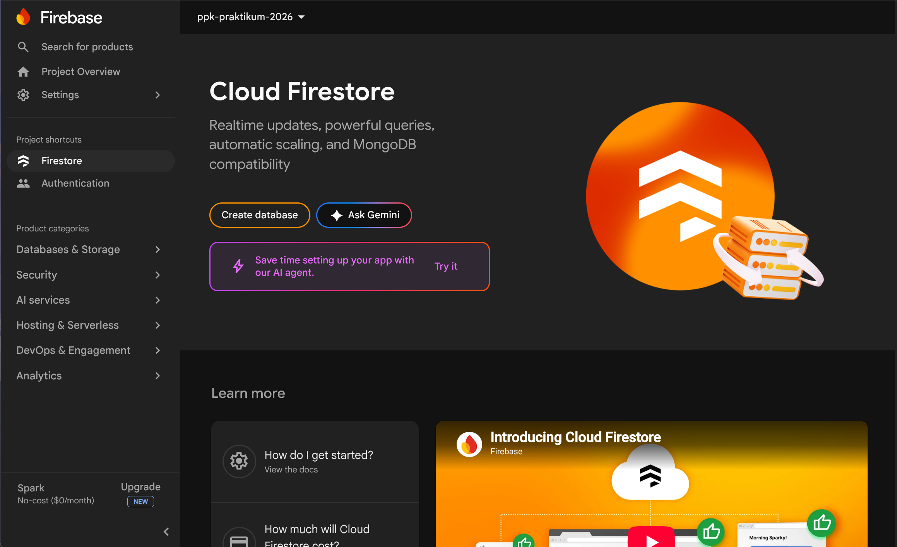
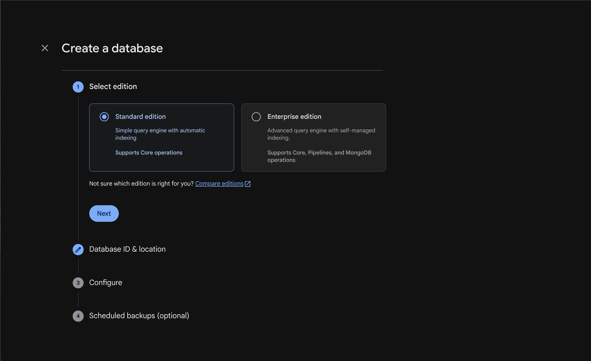
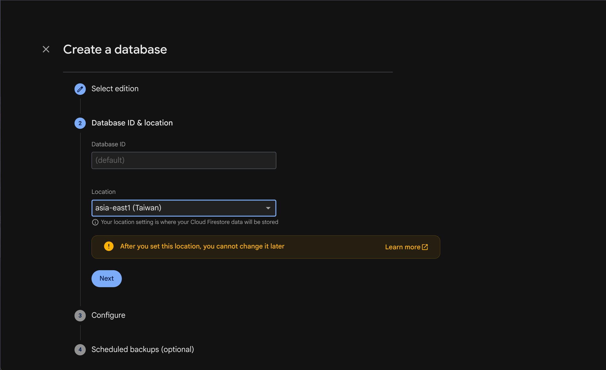
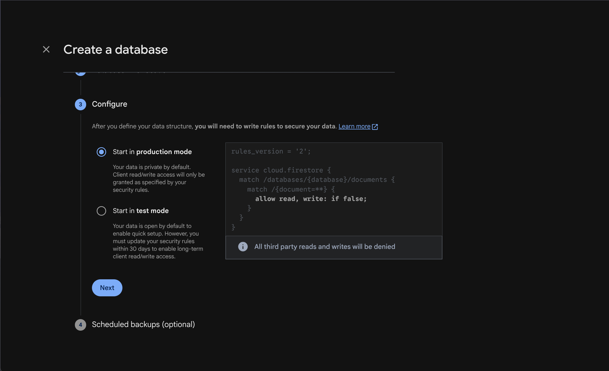

# Setup Cloud Firestore

Panduan ini menyiapkan database Cloud Firestore pada project Firebase. Langkah-langkahnya mencakup pemilihan edisi, lokasi penyimpanan, dan mode keamanan awal agar database siap dipakai dengan konfigurasi akses yang dipahami.

1. Dari halaman project, buka **Firestore** lalu pilih **Create database**.
   
   > **Gambar:** Halaman Cloud Firestore sebelum database dibuat. Tekan **Create database** untuk memulai.
2. Pilih **Standard edition**.
   
   > **Gambar:** Pilihan edisi database. Untuk penggunaan dasar aplikasi, pilih **Standard edition**.
3. Pilih ID database dan lokasi penyimpanan. Lokasi tidak dapat diubah setelah database dibuat.
   
   > **Gambar:** Konfigurasi ID dan lokasi database. Pilih lokasi dekat pengguna aplikasi dan pastikan pilihan tepat sebelum lanjut karena tidak dapat diubah kemudian.
4. Pilih mode awal database dan lanjutkan proses pembuatan.
   
   > **Gambar:** Pilihan awal Security Rules. Production mode memulai dengan akses ditolak.

---

[Kembali: Setup Project Firebase](Setup%20Project%20Firebase.md)

[Awal: Beranda Firebase](Firebase%20Console.md)

[Lanjut: Setup Authentication](Setup%20Authentication.md)
