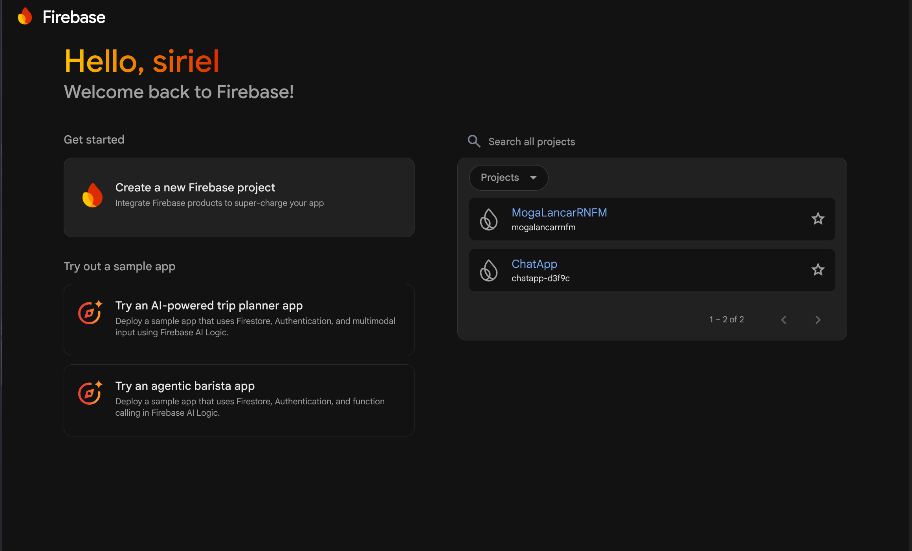
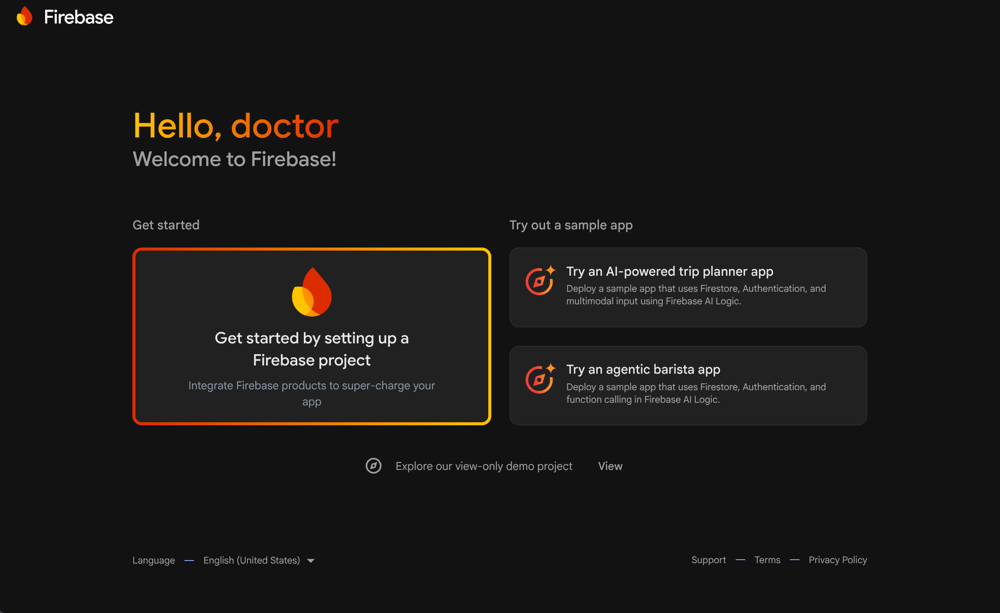
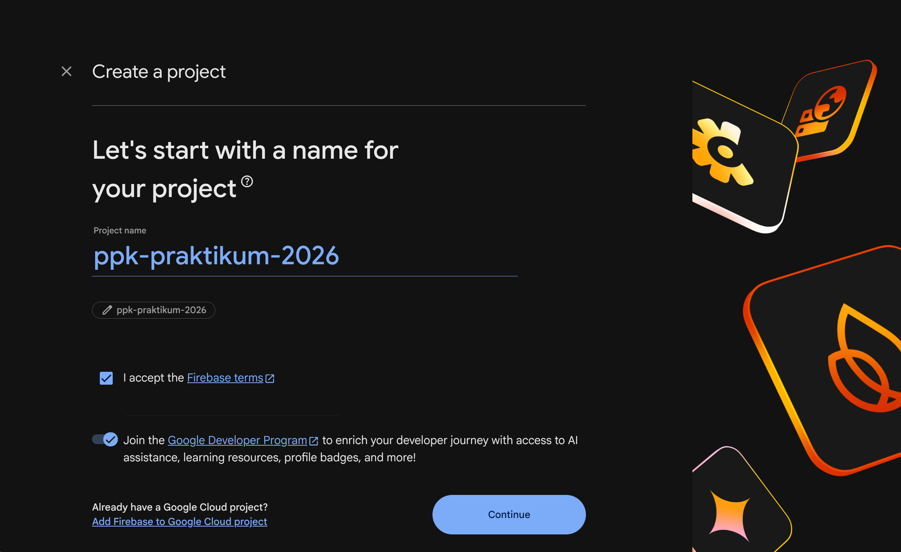
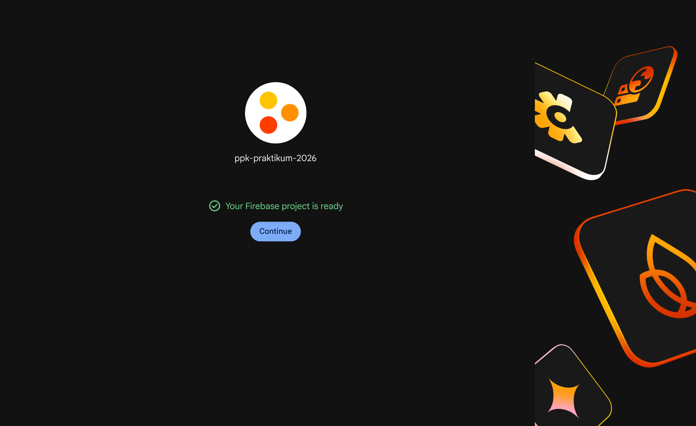
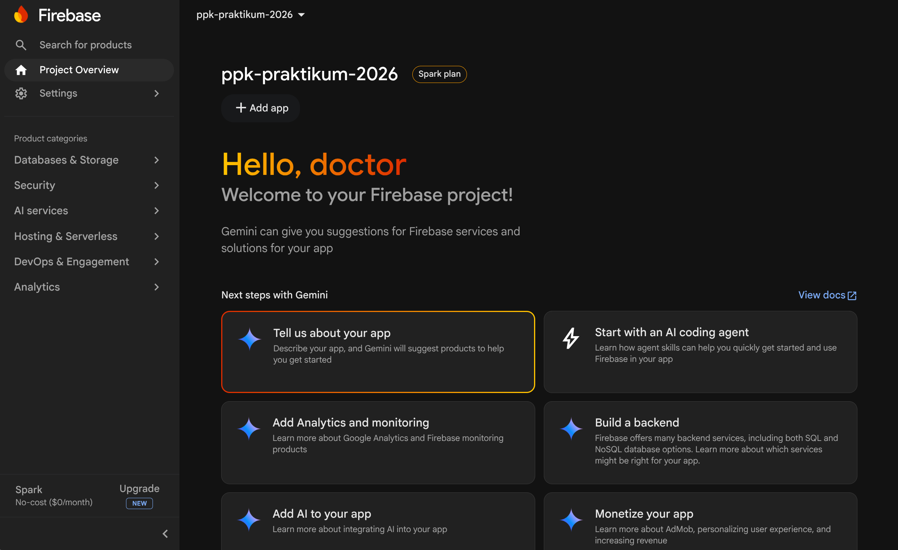

# Setup Project Firebase

Panduan ini menjelaskan pembuatan project Firebase baru dari Console. Tujuannya menyediakan satu project sebagai tempat mengelola aplikasi, database, dan layanan autentikasi yang akan digunakan React Native.

1. Buka [Firebase Console](https://console.firebase.google.com/).
   
   > **Gambar:** Halaman awal Firebase Console. Pilih opsi membuat project baru jika belum memiliki project.
2. Pilih **Get started by setting up a Firebase project**, lalu masukkan nama project.
   
   > **Gambar:** Kartu untuk memulai setup project Firebase dari halaman awal.
   
   > **Gambar:** Form pembuatan project. Masukkan nama yang mudah dikenali; nama project dapat berbeda dari nama aplikasi.
3. Ikuti langkah setup project. Google Analytics bisa diaktifkan sesuai kebutuhan.
   
   > **Gambar:** Konfirmasi bahwa project berhasil dibuat. Tekan **Continue** untuk membuka console project.

4. Setelah selesai, halaman utama project Firebase akan terbuka.
   
   > **Gambar:** Halaman utama project. Dari sini layanan seperti Firestore, Authentication, dan pengaturan aplikasi dapat dibuka.

---

[Kembali: Beranda Firebase](Firebase%20Console.md)

[Lanjut: Setup Cloud Firestore](Setup%20Cloud%20Firestore.md)
