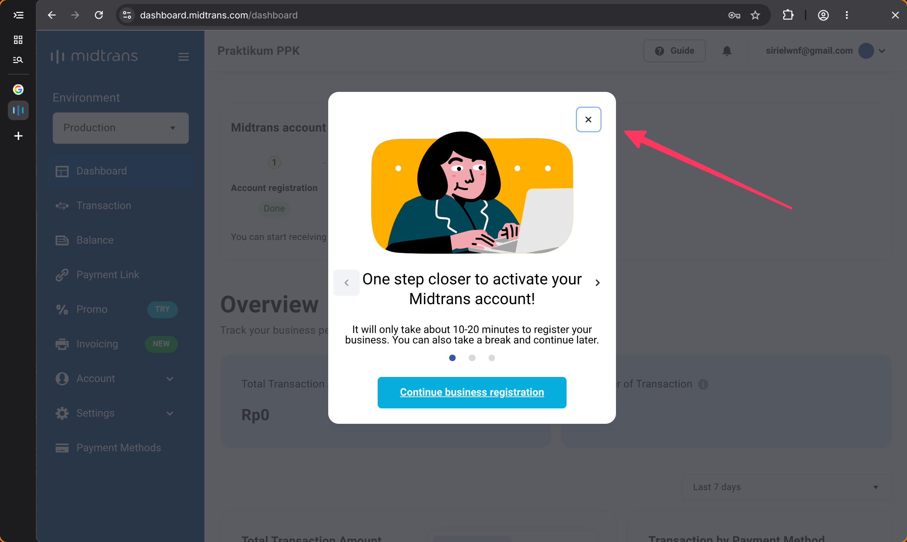
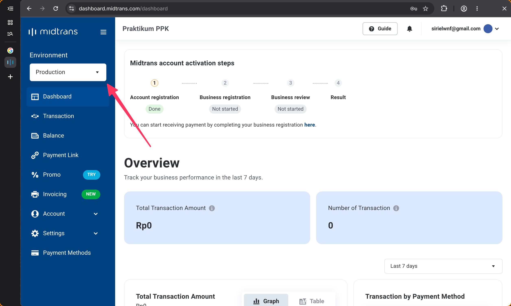
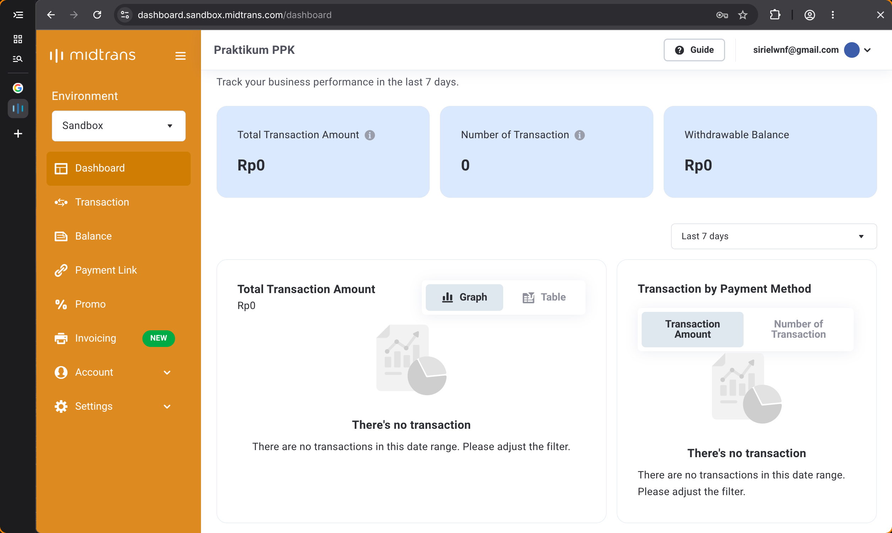

# Payment Gateway dengan Midtrans

Payment gateway adalah layanan yang menghubungkan aplikasi atau toko dengan berbagai metode pembayaran, memproses transaksi, dan menyampaikan status pembayaran. Pada pertemuan ini kita menyiapkan akun Midtrans dan mengenali lingkungan **Sandbox**, yaitu lingkungan simulasi untuk mencoba integrasi tanpa memproses pembayaran sungguhan. Setelah akun siap, integrasi teknis dapat dilanjutkan dengan mengikuti dokumentasi resmi Midtrans.

## Menyiapkan akun Midtrans

1. Buka [halaman pendaftaran Midtrans](https://dashboard.midtrans.com/register) untuk membuat akun. Gunakan alamat email yang dapat diakses karena Midtrans akan mengirimkan tautan verifikasi.
2. Isi formulir pendaftaran dengan data yang diminta. Periksa kembali alamat email dan informasi akun sebelum mengirim formulir.
3. Buka email dari Midtrans dan lakukan verifikasi melalui tautan yang tersedia. Verifikasi diperlukan agar akun dapat digunakan untuk masuk ke dashboard.
4. Setelah masuk ke dashboard, mungkin muncul pop-up panduan aktivasi akun. Untuk mengikuti langkah praktikum ini, tutup pop-up melalui tombol **X**. Pop-up tersebut hanya berisi panduan lanjutan dan dapat dibuka atau diselesaikan kemudian.

   

## Beralih ke lingkungan Sandbox

5. Temukan bagian **Environment** pada panel kiri dashboard. Klik pilihan environment yang sedang aktif, lalu pilih **Sandbox**. Pastikan label yang terlihat adalah “Sandbox” sebelum melanjutkan.

   

   Sandbox digunakan untuk pengembangan dan pengujian. Transaksi di lingkungan ini bersifat simulasi, sehingga tidak memindahkan dana sungguhan. 

6. Setelah berpindah, dashboard akan menampilkan lingkungan Sandbox. Perhatikan alamat dashboard yang memuat `sandbox` serta label **Sandbox** pada bagian Environment. Tampilan ini menandakan bahwa pengujian berikutnya dilakukan di lingkungan simulasi. Data ringkasan transaksi dapat masih kosong jika belum ada transaksi uji.

   

## Langkah selanjutnya

Setelah memahami pemilihan environment, lanjutkan integrasi sesuai kebutuhan aplikasi dengan membaca [dokumentasi resmi Midtrans](https://docs.midtrans.com/). Pilih panduan integrasi yang sesuai dengan platform dan produk pembayaran yang digunakan, lalu pastikan pengujian dilakukan di Sandbox sebelum menyiapkan konfigurasi Production.
